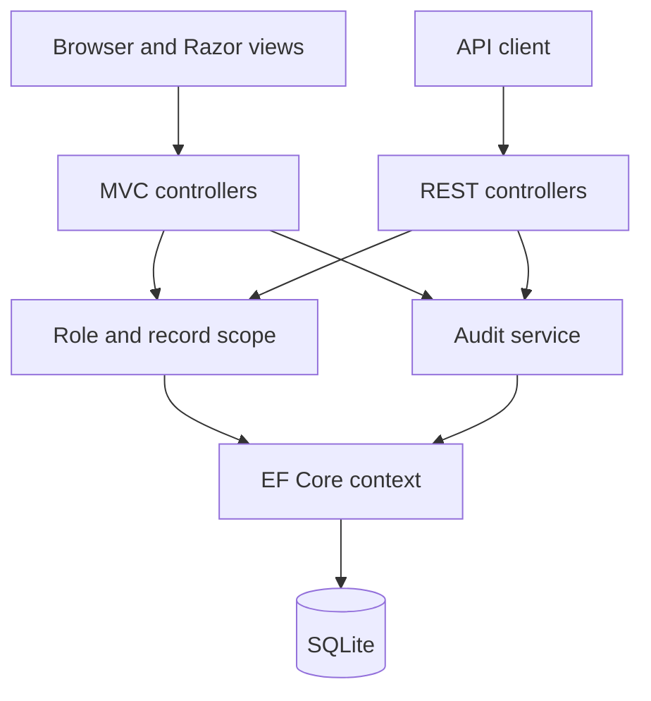

<div align="center">

# AcxiomCRM

**Customer relationship and sales pipeline management**

[](https://acxiomcrm-65sa.onrender.com/)
[](https://github.com/Anav-000/AcxiomCRM)

[](https://dotnet.microsoft.com/apps/aspnet)
[](https://learn.microsoft.com/ef/core/)
[](https://www.sqlite.org/)
[](https://www.chartjs.org/)

[Live sign-in](https://acxiomcrm-65sa.onrender.com/Account/Login) · [Features](#features) · [Local setup](#local-setup) · [Architecture](#architecture-and-database) · [REST API](#rest-api) · [Verification](#verification)

Developed by [Arnav Kumar](https://github.com/Anav-000)

</div>

## Overview

AcxiomCRM helps sales teams manage customers, qualify leads, track opportunities, and coordinate follow-ups. The Razor interface and REST API apply role and record-level access controls. Managers can review team pipeline and reports, and administrators can manage accounts and inspect audit history.

The hosted demo uses synthetic data and requires a hosted account for protected screens. Follow the local setup below to reproduce all three roles. The Render Free service can take time to wake up, and its local SQLite data can reset after a restart or redeploy.

## Features

| Module | Workflow | Search and filters |
| --- | --- | --- |
| Customers | Create, view, edit, and deactivate customers. Customer codes and normalized email and phone values are unique. | Name, email, phone, company, status |
| Leads | Capture, assign, qualify, and convert a lead into a customer, with an optional opportunity. | Name, company, status, assigned user |
| Opportunities | Create, edit, and deactivate deals. Track pipeline stages, weighted forecasts, and Won/Lost outcomes. | Opportunity name, customer, stage, status |
| Follow-ups | Schedule, reschedule, complete, and cancel follow-ups. Review pending and overdue work. | Date, status, assignee, related customer or lead |
| Activities | Record calls, meetings, emails, and tasks against CRM records. | Activity type, date, status, assigned user |
| Administration | Manage users, roles, account status, password resets, lockouts, and audit events. | User and role filters, plus audit filters for action, module, user, and date |

## Local setup

Install the **.NET 8 SDK**. SQLite is embedded, so setup requires no separate database service. Run the following in PowerShell.

```powershell
git clone https://github.com/Anav-000/AcxiomCRM.git
Set-Location AcxiomCRM
dotnet --version
dotnet restore
dotnet build -c Release
$env:ASPNETCORE_ENVIRONMENT = "Development"
dotnet run -c Release --no-build --no-launch-profile --urls "http://localhost:5234"
```

Open [http://localhost:5234](http://localhost:5234). Startup applies EF Core migrations, creates `AcxiomCRM.db` when needed, and seeds the Identity roles. Development also seeds the demo users. If PowerShell cannot find the SDK installed under Local AppData, run `$env:PATH = "$env:LOCALAPPDATA\Microsoft\dotnet;$env:PATH"`.

To manually apply migrations, run `dotnet tool restore` followed by `dotnet ef database update`.

### Demo accounts

Set the password variables **before first launch against a fresh database** to choose your own local demo credentials. Each password needs at least eight characters and must include uppercase and lowercase letters, a digit, and a symbol.

| Role | Default seed email | Password override |
| --- | --- | --- |
| Admin | `admin@acxiomcrm.local` | `ADMIN_PASSWORD` |
| Manager | `manager@acxiomcrm.local` | `MANAGER_PASSWORD` |
| Sales Executive in the Manager's team | `sales@acxiomcrm.local` | `SALES_PASSWORD` |
| Sales Executive outside that team | `sales2@acxiomcrm.local` | `SALES2_PASSWORD` |

The corresponding email overrides are `ADMIN_EMAIL`, `MANAGER_EMAIL`, `SALES_EMAIL`, and `SALES2_EMAIL`. These variables provision new seed accounts. An existing account retains its password until an Admin resets it.

## Access control and audit

| Role | Record scope | Administration |
| --- | --- | --- |
| Admin | Organization-wide CRM, Dashboard, and reports | Users, role assignments, lockouts, password resets, and full system audit |
| Manager | Own work and direct reports' CRM records, pipeline, and reports | Team-scoped audit report at `/Reports/Audit` |
| SalesExecutive | Assigned CRM records, Dashboard, and permitted reports | Account self-service |

Public registration assigns `SalesExecutive`. ASP.NET Core Identity handles cookie authentication, password hashing, and account lockout after five failed attempts for 15 minutes. The server applies role and record-level access checks to MVC requests and protected API routes. Razor forms use anti-forgery protection and unobtrusive validation. EF Core handles database queries and parameterization.

Audit entries capture the actor, action, entity, record ID, before/after values where applicable, timestamp, and IP address when available. Events include login, failed login, lockout, logout, record creation, updates, deactivation, conversion, role changes, and password reset actions.

## Dashboard and reports

The Dashboard shows total customers, total and open leads, total and open opportunities, won and lost opportunities, total open pipeline value, and pending follow-ups. The KPIs and charts use data within the signed-in user's scope.

- **Date filters** cover all time, today, this week, this month, and a custom range.
- **Lead status chart** covers New, Contacted, Qualified, Lost, and Converted.
- **Pipeline chart** covers Qualification, Proposal, Negotiation, Won, and Lost.
- **Monthly Sales chart** shows won revenue over six months, grouped by expected close date.

The [Reports controller](Controllers/ReportsController.cs) exposes eight reports.

| Report | Route | Data shown |
| --- | --- | --- |
| Customers | `/Reports/Customers` | Customer status, owner, and creation date |
| Leads | `/Reports/Leads` | Source, status, owner, and conversion |
| Follow-ups | `/Reports/FollowUps` | Scheduled activity, status, owner, and overdue work |
| Opportunities | `/Reports/Opportunities` | Stage, amount, probability, and expected close date |
| Pipeline | `/Reports/Pipeline` | Stage and owner totals, including weighted pipeline |
| Sales and conversion | `/Reports/SalesConversion` | Lead conversion and opportunity outcomes |
| User activity | `/Reports/UserActivity` | Activity counts by user |
| Audit | `/Reports/Audit` | Organization-wide for Admin and team-scoped for Manager |

## Business validation

- **Customers** require a name, a valid email, and a 10-digit phone number. The database enforces email and phone uniqueness independently after normalization.
- **Leads** require a name, valid contact information, a positive expected value, and a configured status. New leads start at **New**. A qualified lead can be converted through the conversion workflow, which saves the linked records and audit entries together.
- **Opportunities** require a positive amount, probability between 0 and 100 inclusive, and a close date on or after today while open. Stage determines the Open, Won, or Lost outcome. **Weighted value = Amount × Probability / 100.**
- **Follow-ups** reject past dates on creation or when scheduled as Planned. Completing overdue work preserves the originally scheduled date.

The UI validates required fields, format, length, and ranges. The server also validates direct requests, including business rules and ownership of linked records.

## Architecture and database

**Stack** · ASP.NET Core 8 MVC and Razor, ASP.NET Core Identity, EF Core, SQLite, Bootstrap 5, jQuery unobtrusive validation, Chart.js, and Docker.



| Location | Responsibility |
| --- | --- |
| [Controllers](Controllers/) and [API controllers](Controllers/Api/) | MVC routes and REST endpoints |
| [Services](Services/) | Scoped access, audit events, and verification runners |
| [Models](Models/), [ViewModels](ViewModels/), and [DTOs](DTOs/) | Persistence entities, forms and views, and API contracts |
| [Data](Data/) and [Migrations](Migrations/) | EF Core context, Identity setup, seed data, and schema history |
| [Views](Views/) and [wwwroot](wwwroot/) | Razor UI, validation scripts, and static assets |

| Entity | Primary key | Assignment fields |
| --- | --- | --- |
| Customer | `CustomerId` | `CustomerCode`, `CustomerName`, `Email`, `Phone`, `CompanyName`, `Address`, `City`, `State`, `Status`, `CreatedDate`, `CreatedBy` |
| Lead | `LeadId` | `LeadCode`, `LeadName`, `Email`, `Phone`, `CompanyName`, `Source`, `Status`, `ExpectedValue`, `CreatedDate`, `AssignedTo` |
| Opportunity | `OpportunityId` | `OpportunityName`, `CustomerId`, `LeadId`, `Amount`, `Stage`, `Probability`, `ExpectedCloseDate`, `Status`, `CreatedDate`, `AssignedTo` |
| FollowUp | `FollowUpId` | `CustomerId`, `LeadId`, `FollowUpDate`, `FollowUpType`, `Remarks`, `Status`, `AssignedTo` |
| Activity | `ActivityId` | `ActivityType`, `Subject`, `Description`, `ActivityDate`, `CustomerId`, `LeadId`, `AssignedTo`, `Status` |
| AuditLog | `AuditLogId` | `UserId`, `Action`, `EntityName`, `RecordId`, `OldValue`, `NewValue`, `CreatedDate`, `IpAddress` |

Opportunities belong to customers and may retain a source lead. Follow-ups and activities can reference a customer, lead, or opportunity. The migrations `InitialCreate`, `AddPhase2Schema`, and `AddPhase3Schema` capture schema evolution, including ownership, customer uniqueness, relationships, and soft deletion. Identity maintains its own users and roles tables.

## REST API

Use the Identity session cookie for protected resources. Sign in with `POST /api/auth/login` and a JSON body containing `email` and `password`. Keep the returned cookies. After signing in, call `GET /api/auth/csrf` and send its token as `X-XSRF-TOKEN` on CRM mutations. Payload contracts are defined in [DTOs/ApiDtos.cs](DTOs/ApiDtos.cs).

| Endpoint | Methods | Operation |
| --- | --- | --- |
| `/api/auth/login` | POST | Create an authenticated session |
| `/api/auth/logout` | POST | End the authenticated session |
| `/api/auth/csrf` | GET | Get an anti-forgery request token |
| `/api/customers` | GET, POST | Search scoped customers or create a customer |
| `/api/customers/{id}` | GET, PUT, DELETE | Read, update, or deactivate a customer |
| `/api/leads` | GET, POST | List or create leads |
| `/api/opportunities` | GET, POST | List or create opportunities |
| `/api/followups` | GET, POST | List or schedule follow-ups |
| `/api/reports/pipeline` | GET | Get open pipeline totals by stage and owner |

Typical responses include `200 OK`, `201 Created`, `400 Bad Request`, `401 Unauthorized`, `403 Forbidden`, and `404 Not Found`. Duplicate customer email or phone returns `409 Conflict`. A locked account can return `423 Locked` at API sign-in.

## Verification

Run the four CLI verifiers with a disposable SQLite database because they create and update test records.

```powershell
$env:ConnectionStrings__DefaultConnection = "Data Source=AcxiomCRM-verification.db"
1..4 | ForEach-Object {
    dotnet run -c Release --no-build --no-launch-profile -- "--verify-phase$_"
    if ($LASTEXITCODE -ne 0) { throw "Verification phase $_ failed" }
}
Remove-Item Env:\ConnectionStrings__DefaultConnection
```

### Final acceptance scenario · assignment section 17.19

| Step | Check | Expected behavior |
| --- | --- | --- |
| 1 | Open a protected page signed out | Redirect to sign-in |
| 2 | Register or sign in with a valid user | Dashboard opens |
| 3 | Enter an invalid customer email and phone | Inline errors block submission |
| 4 | Submit invalid customer data directly | Server rejects the request |
| 5 | Enter an opportunity amount of zero or less | Server rejects the amount |
| 6 | Enter probability greater than 100 | Server rejects the probability |
| 7 | Give an open opportunity a past close date | Server rejects the date |
| 8 | Create a follow-up dated before today | Server rejects the date |
| 9 | Sign in as SalesExecutive | Access is limited to assigned records |
| 10 | Sign in as Manager | Team pipeline and reports are available |
| 11 | Sign in as Admin | User, role, and audit administration are available |
| 12 | Create, update, and deactivate a CRM record | Audit captures the operations |
| 13 | Call `/api/customers` while authenticated | API returns scoped JSON |
| 14 | Open the Dashboard | KPI cards and Chart.js charts display authorized data |

The local implementation report recorded passing checks for all 14 steps. Hosted verification is tracked separately. The public sign-in page responds, and authenticated use on Render requires the generated or configured hosted credentials.

## Deployment

[Dockerfile](Dockerfile) builds and publishes the app with .NET 8. [render.yaml](render.yaml) configures a Docker web service on Render with synthetic demo data and generated bootstrap passwords. Set custom bootstrap secrets in the service environment and share evaluator access privately. Use distinct hosted passwords for all seed roles and synthetic data on the public demo. The application listens on port 8080 inside the container.
